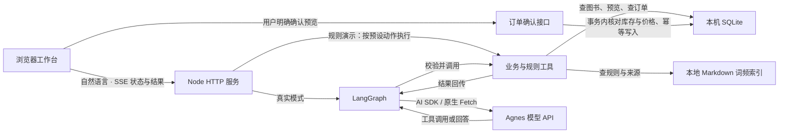

# 书店小管家 · 技术架构

| 模块 | 职责 |
| --- | --- |
| 网页工作台 | 展示库存、工具执行、规则引用和订单；用户在这里确认订单 |
| HTTP 服务 | 管理会话、参数、响应和取消；另提供 OpenAI 兼容代理接口 |
| LangGraph | 根据模型返回决定执行工具还是结束；工具结果送回模型，每轮最多 4 次模型请求 |
| 模型适配层 | 用 AI SDK 或 Fetch 请求已配置型号，不自动换模型 |
| SQLite | 存储图书、订单、预览、会话；确认时重新校验并防止重复扣库存 |
| 规则索引 | 检索教学模拟规则，返回原文片段与文件来源 |

模型能查询、创建预览并解释结果；订单只能经用户确认接口写入。规则演示不请求模型。真实模型验收结果以《验证记录》为准。
